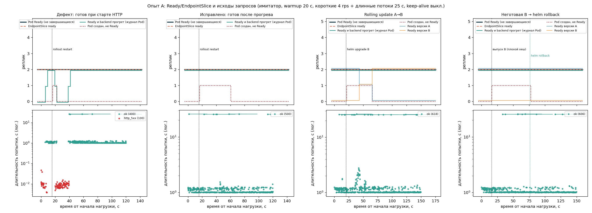
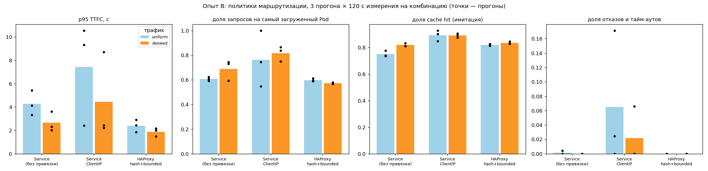
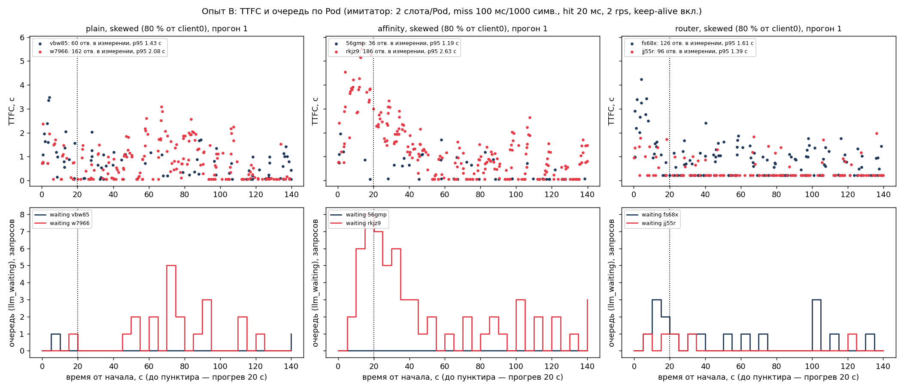
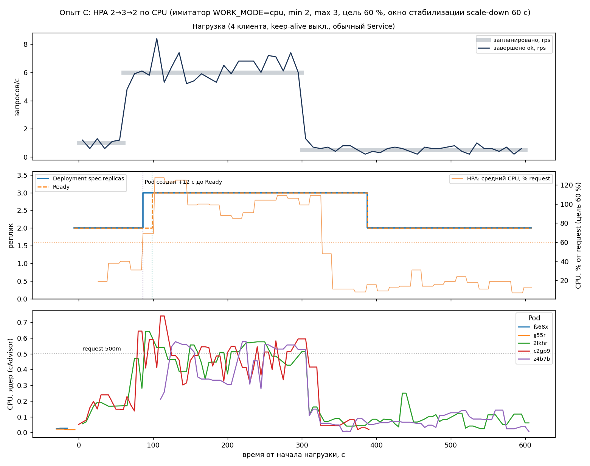

# ДЗ 11. Сервис работает, пользователи ждут

МГТУ, MLOps-26 · стенд: kind на Docker Desktop (Windows 11) · дата прогонов: 14.11.2026

> **Режим backend: `backend_mode=simulated`** во всех опытах основной части. Это управляемый CPU-имитатор
> с настраиваемыми прогревом, очередью, ограничением одновременной обработки, выдачей частями и
> имитацией префиксного кеша. Все числа описывают модель нагрузки имитатора: время до первой части
> ответа — **TTFC**, интервалы между частями — **inter-chunk latency**. TTFT/TPOT/tokens/s не измерялись,
> настоящая модель не подключалась (дополнительный опыт не выполнялся).

[TOC]

## 0. Стенд

### Откуда сервис

Продолжение API из ДЗ 8+9+10 (`hw8910-broken/service.py`, `backends.py`): та же последовательность
«загрузить артефакт → сверить SHA-256 → прогреть → стать готовым», ограничение одновременной обработки
с очередью и отказом до постановки в очередь, версия в ответе берётся из памяти процесса, а не с диска.
Добавлено: потоковая выдача (NDJSON), отдельные `/livez` `/startupz` `/readyz`, метрики Prometheus,
обработка SIGTERM (снятие готовности и дренаж), идентификаторы в каждом ответе и журнале.

| Что | Как |
|---|---|
| Артефакт | `models/sim-A.json`, `models/sim-B.json` (~0,5 КБ, «модель-имитатор»), хеши в `models/SHA256SUMS`; при сборке образа `sha256sum -c` |
| Источник версии для всех реплик | неизменяемый образ `llm-sim:0.1.0` (артефакты внутри); Helm values задают `model.version` и ожидаемый `model.sha256` |
| Проверка версии | при старте `backend.load()` пересчитывает SHA-256 файла; несовпадение → `load_failed`, `/startupz` = 503, Pod не становится Ready |
| Связь ответа с версией | заголовки `X-Request-ID`, `X-Pod`, `X-Model-Version`; финальная строка потока `done` содержит `request_id`, `pod`, `model_version`, `model_sha256`, `backend_mode`, `session_id`, `cache`, `queue_s` |
| Журнал | JSON-строка на событие (`accepted`, `finished`, `cold_request`, `rejected`, `sigterm`, `warm`, `load_failed`) с `request_id`, `session_id`, `pod`, `version` |
| История диалога | передаётся в запросе (`messages`), в Pod не хранится; префиксный кеш — только оптимизация |
| Для настоящих весов (не делалось) | том ReadOnlyMany (NFS/объектное хранилище через CSI) или init-контейнер, скачивающий веса по закреплённой ревизии с проверкой хеша в `emptyDir`; для RWO-тома все реплики пришлось бы держать на одном узле |

### Kubernetes-объекты (`charts/llm-sim`)

| Объект | Назначение |
|---|---|
| Deployment `llm-sim` | 2 реплики, `RollingUpdate maxSurge=1 maxUnavailable=0`, requests 250m/96Mi, limits 1 CPU/256Mi, `terminationGracePeriodSeconds: 60`, `preStop: sleep 5` |
| ConfigMap `llm-sim-config` | все параметры имитатора; checksum ConfigMap в аннотации шаблона → смена values запускает rollout |
| Service `llm-sim` | обычный (kube-proxy iptables, случайный выбор Pod на новое соединение) |
| Service `llm-sim-affinity` | тот же селектор, `sessionAffinity: ClientIP`, timeout 10800 с |
| Service `llm-sim-headless` | DNS только готовых Pod — для маршрутизатора |
| Deployment/Service `llm-router` | HAProxy 3.2: `balance hdr(X-Session-ID)`, `hash-type consistent`, `hash-balance-factor 125` |
| HPA `llm-sim` | autoscaling/v2, CPU, min 2 / max 3 (включается в опыте C) |
| StatefulSet `loadgen` | 4 клиентских Pod с разными IP; генератор запускается `kubectl exec` |

Параметризованы в values: образ (`image.repository/tag`), версия модели (`model.version/sha256`), прогрев
(`backend.warmupSeconds`), число реплик (`replicaCount`), режим проб (`probes.mode`), параметры имитатора,
политики и HPA. Конфигурации сравниваемых опытов — `experiments/values-exp-{a,b,c}.yaml`.

### Пробы — три разных назначения

| Проба | Путь | Что значит провал | Параметры |
|---|---|---|---|
| startup | `/startupz` | артефакт не загружен или прогрев не закончен; пока не пройдена, liveness/readiness не выполняются | период 2 с, порог `(warmup + 30)/2` = 25 → до 50 с на старт |
| readiness | `/readyz` | не прогрет, ошибка загрузки или получен SIGTERM → исключить из EndpointSlice | период 2 с, 1 провал |
| liveness | `/livez` | event loop не отвечает → перезапуск. Не зависит от прогрева и перегрузки, иначе очередь вызывала бы перезапуски | период 10 с, тайм-аут 3 с, 3 провала |

Исходный дефект (`probes.mode=http`): startup и readiness смотрят в `/livez`, то есть готовность = «HTTP-процесс поднялся».

### Мониторинг

Prometheus (чарт prometheus 29.47.0, Prometheus v3.16.0) собирает метрики с **каждого Pod** через
`kubernetes_sd_configs` (job `kubernetes-pods`, аннотации `prometheus.io/scrape|port|path` в шаблоне Pod),
cAdvisor — CPU/RAM контейнеров, kube-state-metrics — Ready-реплики и HPA. Интервал сбора 5 с. Grafana 12.3.1,
дашборд провиженится из ConfigMap; экспорт — `monitoring/grafana-dashboard.json` (генератор
`monitoring/make_dashboard.py`). Метки метрик ограничены: `outcome`, `result`, `version` + `pod/namespace` от SD;
`request_id`/`session_id` есть только в журнале.

### Версии, ресурсы и размер

См. `results/footprint.txt` (снят после опытов). Кратко: Docker Desktop 29.9.2 (WSL2, 16 vCPU, 15,3 ГиБ RAM
для ВМ), kind v0.33.0 + `kindest/node:v1.37.0@sha256:a1ed56cf…` (Kubernetes v1.37.0), kubectl v1.36.1,
helm v4.3.1, чарты prometheus 29.47.0 / grafana 10.5.15 / metrics-server 3.14.0, HAProxy 3.2.26
(`haproxy:3.2-alpine@sha256:1c3568e5…`), базовый образ `python:3.12-slim@sha256:5e2bdb1b…`; Python-пакеты
закреплены в `app/requirements.lock`. Свободно на диске перед запуском: 822 ГБ из 953 ГБ.

Ограничения, выбранные заранее: образ сервиса 205 МБ; Prometheus — PVC 1 Гиб, `retention 48h`,
`retentionSize 768MB`; Grafana без тома; лимиты CPU/RAM у всех контейнеров стенда. Удаление стенда —
`bash deploy/teardown.sh` (`kind delete cluster --name hw11` + `docker image rm llm-sim:0.1.0`).

## 1. Опыт A. Прогрев, обновление и откат

**Нагрузка во всех шагах A** (`experiments/exp_a.py`, `values-exp-a.yaml`): прогрев backend 20 с;
клиент `loadgen-0` — короткие ответы (16–20 частей по 50 мс), пуассоновский поток 4 запроса/с; клиент
`loadgen-1` — длинные потоки по 500 частей (≈ 25 с), 0,05–0,1 запроса/с. Keep-alive у клиентов выключен,
чтобы каждый запрос заново выбирал Pod через Service. Тайм-аут клиента 60 с. Линия Ready/EndpointSlice
снимается раз в секунду (`timeline.jsonl`), журналы Pod — `pods*.jsonl`, сырые попытки — `short.jsonl`, `long.jsonl`.



*График 1. Верх: число Pod в Ready (без завершающихся), ready-адреса в EndpointSlice обычного Service,
Ready **и** фактически прогретые (по событию `warm` в журнале Pod), созданные, но не Ready Pod, Ready по версиям.
Низ: каждая попытка — точка (время отправки × длительность, лог. шкала), длинные потоки — отрезки
от отправки до конца. Ось X — секунды от начала нагрузки.*

### 1.1 Прогрев: исходный дефект → исправление

**Гипотеза.** Если startup/readiness проверяют только то, что HTTP-процесс отвечает, новый Pod попадает в
EndpointSlice за секунды после старта и получает рабочие запросы, пока backend ещё 20 с греется.

**Воспроизведение** (`probes.mode=http`, `kubectl rollout restart` на 15,6 с при нагрузке):

| | Дефект (`http`) | Исправлено (`warm`) |
|---|---|---|
| новый Pod 1: создан → Ready → прогрет (журнал) | 16,2 → **19,2** → 37,4 с | 16,1 → 36,9 (warm) → **38,3** с (Ready) |
| новый Pod 2: создан → Ready → прогрет | 19,2 → **22,2** → 40,7 с | 38,3 → 59,4 (warm) → **60,5** с |
| Ready раньше конца прогрева | ≈ 18 с у каждого Pod | нет: Ready через 1,1–1,4 с **после** `warm` (период пробы 2 с) |
| запланировано / отправлено / успешно | 500 / 500 / **400** | 500 / 500 / **500** |
| HTTP 5xx (`503 backend_warming`) | **100** | **0** |
| событий `cold_request` в журналах Pod | **100** (сходится 1:1 с клиентом по `request_id`) | **0** |
| p95 TTFC успешных коротких, n | 0,260 с, n = 394 | 0,260 с, n = 491 |

Строка «создан → Ready» и EndpointSlice — из `timeline.jsonl`, «прогрет» — событие `warm` из журнала Pod.
26 из 100 отказов пришлись на первые 8 с — ещё до `rollout restart`: Pod, созданные самим `helm upgrade`
на `probes.mode=http`, тоже сразу стали Ready, и **`kubectl rollout status` сообщил об успешном выпуске,
пока оба backend были холодными**. При дефекте rollout к тому же идёт быстрее, чем греется backend: оба
старых Pod завершены к 22 с, а первый новый прогрет только к 37 с — 15 с без единого рабочего backend.

**Причина.** Готовность определялась состоянием HTTP-сервера, а не backend. Сервис сам защищён:
непрогретый backend отвечает `503 backend_warming` и пишет `cold_request` — без этого он бы молча обслуживал
запросы непрогретым.

**Изменение.** startupProbe → `/startupz` (200 только после загрузки артефакта, проверки хеша и прогрева),
порог 25 × 2 с = 50 с > прогрева 20 с с запасом; readinessProbe → `/readyz` (прогрет и не получал SIGTERM);
liveness остаётся `/livez` с отдельной целью. **Повтор того же опыта:** 0 отказов, 0 `cold_request`,
EndpointSlice получает адрес нового Pod только после `warm`. Красный/зелёный прогон той же проверки —
`results/tests/red-probes-http.log` / `green-probes-warm.log` (раздел 5).

### 1.2 Rolling update A → B под нагрузкой с длинными потоками

**Гипотеза.** С `maxUnavailable: 0`, readiness по прогреву, `preStop: sleep 5` и `terminationGracePeriodSeconds: 60`
(> длинного потока 25 с + preStop) обновление проходит без 5xx и без оборванных потоков.

**Опыт** (`rollout-A-to-B`): первый длинный поток отправлен на 8,4 с, `helm upgrade` на B — на 20,5 с,
`rollout status` завершился на 65,5 с (45 с: два Pod по ~22 с прогрева, последовательно из-за `maxSurge: 1`).

| Событие | Время, с |
|---|---|
| B‑Pod 1 создан → Ready; A‑Pod `sd882` → Terminating | 21,2 → 43,4; 43,4 |
| B‑Pod 2 создан → Ready; A‑Pod `qrxbj` → Terminating | 43,4 → 65,6; 65,6 |
| длинный поток на `sd882`, начат до SIGTERM | 35,8 → **61,3** (дописан через 18 с после Terminating) |
| длинный поток на A, пересекающий начало обновления | 8,4 → 34,1 |
| последний ответ версии A / первый ответ версии B | 65,8 / 43,1 |

| Поток | запланировано | успешно | 5xx | оборвано | тайм-аут | p95 TTFC (n) | p95 полного ответа |
|---|---|---|---|---|---|---|---|
| короткие | 596 | 596 | 0 | 0 | 0 | 0,430 с (596) | 1,40 с |
| длинные 25 с | 22 | 22 | 0 | 0 | 0 | 0,264 с (22) | 25,76 с |

**Итог штатного rollout: 0 HTTP 5xx, 0 незавершённых потоков** при 4 запросах/с и тайм-ауте 60 с.
Механизм дренажа виден в журнале (`warmup-warm/pods-*.jsonl`): при SIGTERM процесс пишет
`{"event":"sigterm","running":1,...}`, снимает `/readyz`, перестаёт принимать новые соединения и дописывает
активный поток; Pod исчезает только после этого. Временный рост задержки на 40–50 с — прогретая, но
одна реплика B принимает долю трафика, пока последняя A завершается (p95 TTFC 0,43 с против 0,26 с без обновления).

### 1.3 Заведомо неготовая B и откат

`helm upgrade` с `model.version=B` и **неверным** `model.sha256` (`000…0`) на 16,2 с.
Новый Pod `pvxjg`: загрузка падает на проверке хеша, `/startupz` = 503, через 50 с startupProbe перезапускает
контейнер (`0/1 Running, 1 restart` — `bad-release/bad-pods.txt`). В EndpointSlice он `ready: false,
serving: false` (`bad-endpointslices.yaml`), поэтому из трафика исключён; оба Pod A продолжают обслуживать.
`helm history`: ревизия 7 «Upgrade complete» — **Helm без `--wait` считает выпуск успешным**, хотя rollout
застрял; признак сбоя — `rollout status`/неготовый Pod, а не статус Helm.

Откат: `helm rollback llm 6 --wait` на 76,4 с, 0,6 с (старый ReplicaSet A не уменьшался из‑за
`maxUnavailable: 0`, удаляется только неготовый Pod B). За весь шаг: 606 из 606 ответов успешны,
**все 606 — версии A** (`model_version` и `model_sha256` в финальной строке каждого потока), 0 отказов.
Отдельная проверка версии после отката — `tests/test_k8s_version.py` (раздел 5).

### 1.4 Принудительное завершение процесса

`POST /admin/crash` → `os._exit(137)` в Pod `7dv8w` на 30,6 с от начала нагрузки (аналог OOM/segfault:
без SIGTERM, без дренажа). Клиент повторяет до 2 раз с backoff 0,5 с × номер попытки; повторы
записаны отдельными строками с `attempt` = 2, 3.

| Показатель | Значение |
|---|---|
| оборвано потоков на упавшем Pod (попытки) | 3 (`truncated`: 1 длинный, 2 коротких) |
| попытки с отказом соединения в первые 1,3 с | 6 (`connect_error`: kube-proxy ещё направлял на мёртвый адрес) |
| попытка, попавшая в уже перезапущенный, но холодный процесс | 1 (`503 backend_warming` через 1,7 с) |
| обнаружение: адрес ушёл из ready EndpointSlice | через **0,7 с** (точность наблюдения 1 с) |
| восстановление: тот же Pod снова ready в EndpointSlice | через **23,9 с** (перезапуск контейнера + прогрев 20 с) |
| запросы: запланировано / отправлено / попыток / повторов | 618 / 618 / 696 / 78 |
| итог по запросам: успешно / отклонено (429) / оборвано / 5xx | 597 / **21** / 0 / 0 |
| спасено повтором | 26 запросов |

**Что оказалось важнее обрыва.** Пока реплика перезапускалась, вся нагрузка (≈ 4,8 занятых слота коротких +
≈ 2,5 длинных потоков в среднем) пришлась на один Pod с 8 слотами: очередь заполнилась до 32, и 13–24 с после
сбоя Pod отвечал `429 queue_full` (89 попыток), а повторы клиента добавляли нагрузку. p95 TTFC коротких в этом
прогоне — 10,6 с. Вывод: двух реплик недостаточно для N−1 при такой нагрузке; повторы нужно ограничивать
бюджетом с jitter, а ёмкость считать с запасом на одну потерянную реплику.
Холодный ответ через 1,7 с показывает, что для Pod, перезапущенного «на месте» (тот же IP), защита в коде
(503 вместо обслуживания холодным backend) нужна и при правильных пробах: kube-proxy обновляет правила
с задержкой.

**Ограничения A.** Один узел kind: нет сетевых задержек между узлами и переноса Pod. Наблюдатель опрашивает
API раз в секунду, поэтому времена событий точны до ~1 с. Журналы Pod собираются `kubectl logs` во время шага;
без внешнего сбора журналов они пропадают вместе с Pod (в первом прогоне так и случилось — повтор с
`LogCollector`).

## 2. Опыт B. Привязка к Pod и горячая реплика

### Условия (одинаковы для всех сравниваемых вариантов)

| Параметр | Значение |
|---|---|
| Реплики | 2 Pod `llm-sim`, `MAX_CONCURRENCY=2` слота, очередь до 16, затем 429 |
| Имитация префиксного кеша (явная, локальная для Pod) | LRU на 128 префиксов; **miss**: 100 мс на 1000 несовпавших символов (документ диалога 4–12 тыс. символов → 0,4–1,2 с); **hit**: 20 мс + пересчёт только новых сообщений (~330 символов ≈ 33 мс) |
| Ответ | 20 частей через 50 мс (≈ 1 с decode) |
| Клиенты | 4 Pod `loadgen-0..3`, IP 10.244.0.13 / .15 / .14 / .16; у каждого 12 своих диалогов |
| Трафик | пуассоновский поток 2 запроса/с суммарно; `uniform` — по 25 %; `skewed` — клиент 0 ≈ 80 % (по расписанию 74–79 %) |
| Список запросов | детерминированный: `workload.schedule(profile, rate, seed)`, seed = номер прогона 1–3; **один и тот же список, длины входов, `max_chunks` и расписание для трёх политик** |
| Фазы | прогрев 20 с (не входит в замеры) + **измерение 120 с**; затем дожидаемся всех ответов (тайм-аут 90 с) |
| Начальное состояние | перед каждым прогоном `rollout restart` → новые Pod с пустым кешем и новыми IP (таблица привязки kube-proxy для них пуста), прогрев backend 5 с |
| Keep-alive | включён у клиентов (пул httpx), сервер держит простаивающее соединение 5 с |
| Порядок | прогоны чередуются по политикам внутри одного seed (`plain → affinity → router`), чтобы дрейф стенда не совпал с политикой |

**Сеть** (`results/exp-b/net-*.txt`): kube-proxy `mode: iptables`. Обычный Service — цепочка
`-m statistic --mode random --probability 0.5`: выбор Pod на **новое TCP-соединение**, а не на запрос.
ClientIP-Service — `-m recent --rcheck --seconds 10800 --rsource --mask 255.255.255.255`: ключ привязки —
**IP источника, который видит kube-proxy, то есть IP клиентского Pod** (SNAT внутри одного узла нет).
HAProxy-маршрутизатор: `balance hdr(X-Session-ID)`, `hash-type consistent`, `hash-balance-factor 125`,
адреса Pod берёт из headless Service (только готовые), проверка `/readyz` раз в 1 с.

Прогон `router-skewed-run1` пришлось повторить: во время первой попытки ноутбук уснул, и генератор
зафиксировал это сам — максимальное отставание фактической отправки от запланированной 6597 с (в остальных
прогонах ≤ 0,06 с). Испорченный прогон сохранён в `results/exp-b-invalid/` и в сравнение не входит.

### Результаты: 3 прогона на комбинацию



*График 3. Столбец — среднее по трём прогонам, точки — отдельные прогоны. Метрики — по фазе измерения 120 с.*

| Политика | Трафик | p95 TTFC, с (среднее; мин–макс) | p50 TTFC, с | доля на загруженный Pod | доля cache hit | доля отказов+тайм-аутов |
|---|---|---|---|---|---|---|
| Service без привязки | uniform | 4,29 (3,32–5,42) | 0,77 | 0,61 | 0,75 | 0,001 |
| Service ClientIP | uniform | **7,42** (2,41–10,55) | 3,11 | **0,76** (0,55–1,00) | 0,89 | **0,065** (до 0,17) |
| HAProxy hash+bounded | uniform | **2,40** (1,86–2,90) | 0,22 | 0,60 | 0,82 | 0 |
| Service без привязки | skewed | 2,66 (2,03–3,62) | 0,62 | 0,69 | 0,82 | 0 |
| Service ClientIP | skewed | **4,45** (2,21–8,70) | 2,30 | **0,82** | 0,89 | 0,022 |
| HAProxy hash+bounded | skewed | **1,89** (1,48–2,17) | 0,32 | 0,57 | 0,83 | 0 |

Число успешных ответов в каждом прогоне 217–282 (столбец `n_ok` в `summary-exp-b.csv`), все отказы — `429
queue_full` или тайм-аут 90 с, 5xx и обрывов нет. Сравнивать можно политики внутри профиля:
у uniform и skewed разные расписания (разный ключ генератора) и разное число запросов.

### Горячая реплика ждёт, у другой — свободная ёмкость



*График 2. Прогон skewed seed 1, одинаковый список запросов. Верх — TTFC каждого ответа по Pod; низ —
`llm_waiting` по Pod из Prometheus (шаг 5 с). При ClientIP Pod `rkjz9` обслужил 84 % запросов, очередь
доходила до 8, p95 TTFC 2,6 с в фазе измерения (до 5,7 с в прогреве), а у `56gmp` очередь всё время 0 (p95 1,2 с). HAProxy делит те же запросы
57/43 и держит p95 ≈ 1,5 с.*

Самый тяжёлый случай — **ClientIP при равномерном трафике**: все четыре клиента случайно привязались к одному
Pod (`affinity-uniform-run2`: 245 из 245 запросов на `zrqjq`, средняя очередь 7,4 с, 42 отказа 429), вторая
реплика простаивала весь прогон. В `affinity-uniform-run1` к одному Pod привязались 3 клиента из 4 (74 %,
p95 9,9 с против 0,7 с у второго).

### Когда ожидаемый перекос не возник — объяснение по трассе

| Прогон | Ожидание | Что показала трасса `client → pod` |
|---|---|---|
| `affinity-uniform-run3` | ClientIP даёт горячую реплику | клиенты 0 и 2 → `xxtg4`, клиенты 1 и 3 → `8drtj`: случайный выбор при первом соединении разложил клиентов 2/2, доли 55/45, p95 2,4 с — как у HAProxy. Привязка по IP даёт перекос не всегда, а с вероятностью, зависящей от числа клиентов. |
| `affinity-skewed-run3` | у горячей реплики хуже задержка | клиент 0 (182 запроса) → `bj7fx`, клиенты 1–3 (61) → `tr9j6`. Доля 75/25, но p95 на горячем Pod 2,15 с, а на холодном 2,54 с: у горячего 90 % cache hit (prefill ~50 мс), у холодного три чужих клиента с промахами по 0,4–1,2 с. Перекос по числу запросов не стал перекосом по задержке. |
| `plain-skewed-run2` | без привязки доли ≈ 50/50 | клиент 0 отправил 130 запросов на `7k65f` и 84 на `kr8sm`: keep-alive закрепляет соединения из пула за Pod, и «обычный» Service ведёт себя как частичная привязка (в среднем 0,69 на загруженный Pod при skewed). |

### Причина, исправление, повтор

**Причина.** ClientIP-привязка закрепляет **всех пользователей клиента** (или NAT/шлюза) за одной репликой.
Ключ слишком крупный: 80 % трафика попадают в одну очередь, ёмкость второй реплики не используется. Обычный
Service решает это лишь отчасти: балансирует соединения, а не запросы, и случайно разносит диалоги по Pod
(cache hit падает до 0,75).

**Исправление — готовая политика** consistent hashing with bounded loads (HAProxy `hash-balance-factor 125`).
Ключ — **сессия** (`X-Session-ID`), а не IP. Диалог идёт на «свою» реплику, пока у неё не больше 125 % средней
загрузки (HAProxy считает активные запросы на сервер), иначе — на следующую по кольцу. Тот же сценарий с тем же
списком запросов (3 × 2 прогона):

* **задержка:** p95 TTFC 2,40 с против 4,29 (без привязки) и 7,42 (ClientIP) при uniform;
  1,89 против 2,66 и 4,45 при skewed; разброс между прогонами минимальный;
* **отказы:** 0 во всех шести прогонах (ClientIP — до 17 %);
* **распределение:** 57–61 % на загруженный Pod при любом профиле;
* **локальность кеша:** доля hit 0,82–0,83 — почти как у ClientIP (0,89) и выше, чем без привязки (0,75).
  Проигрыш в попаданиях (~7 п. п.) дешевле очереди: промах стоит 0,4–1,2 с, а очередь на горячей реплике — секунды.

**Что требует отдельной проверки на настоящем inference engine.** (1) Загрузка как число активных запросов —
грубая мера: для LLM важнее занятые KV-блоки, длина очереди prefill и размер батча, поэтому нужна
cache-aware маршрутизация с этими сигналами (SGLang router, llm-d / Gateway API Inference Extension).
(2) Реальная стоимость промаха — prefill в токенах на данной GPU и влияние на TPOT соседних потоков,
у нас она линейна по символам. (3) Вытеснение KV-кеша по памяти, а не по числу записей. (4) Длина префикса
(одна сессия на ключ — грубо; общий системный промпт между сессиями наш хеш не учитывает).
(5) Маршрутизатор — отдельная точка отказа и лишний хоп (~1 мс у нас); нужны ≥ 2 реплики HAProxy.

**Ограничения B.** Нагрузка задана близко к насыщению (без привязки p95 уже 3–5 с), поэтому различия крупные;
при низкой загрузке политики почти не различаются. Один узел. Ходы одного диалога могут уйти до завершения
предыдущего хода — тогда даже на «своей» реплике будет промах.

## 3. Опыт C. HPA и мониторинг

### Конфигурация

`experiments/values-exp-c.yaml`: `WORK_MODE=cpu` — prefill (30 мс/1000 несовпавших символов) и каждая
часть (8 мс) тратятся **занятым циклом на CPU**, поэтому причина масштабирования наблюдаема. Слотов 8, очередь
32. requests CPU 500m, limits 1. HPA `autoscaling/v2`: min 2, max 3, `averageUtilization: 60`,
scale-up без окна, scale-down — окно стабилизации 60 с, не больше 1 Pod за 15 с (`hpa-yaml.txt`).
Проверка до запуска: `kubectl get apiservice v1beta1.metrics.k8s.io` → `Available=True`; `kubectl top pods`
отдаёт CPU; у всех контейнеров `llm-sim` есть `requests.cpu` (`exp-c/hpa/cpu-requests.txt`).

### 2 → 3 → 2



*График 4. Ramp-нагрузка: 60 с × 1 rps → 240 с × 6 rps → 300 с × 0,5 rps, 4 клиента, обычный Service,
keep-alive выкл. Средний CPU от request по данным HPA, CPU по Pod — cAdvisor.*

| Событие | Время от начала нагрузки |
|---|---|
| рост нагрузки до 6 rps | 60 с |
| HPA: `spec.replicas` 2 → 3, Pod `z4b7b` создан | **86,4 с** (средний CPU ≈ 69 % > 60 %) |
| новый Pod Ready (прогрев 10 с + проба) | **98,4 с** (+12,1 с) |
| нагрузка снижена до 0,5 rps | 300 с |
| средний CPU ниже 60 % | ≈ 325 с |
| HPA: 3 → 2 | **387,6 с** — через 87,6 с после снижения нагрузки (≈ 60 с окна стабилизации + ~25 с задержки метрики) |

За весь прогон 1734 запроса, 1734 успешны, p95 TTFC 0,53 с; третий Pod получил 451 запрос — без привязки
новая реплика сразу участвует в работе.

### Горячая реплика при HPA

Повтор горячей реплики (`exp-c/hot`): skewed 4 rps через ClientIP-Service, keep-alive включён, 300 с.
HPA масштабировал 2 → 3 на 28 с (новый Pod Ready на 42 с), но **третий Pod не получил ни одного запроса**:
клиенты 0, 1, 3 остались на `glftp` (1091 запрос), клиент 2 — на `tl7q6` (77). Через 6 мин HPA вернул 2 реплики.

**Когда средний CPU вызовет масштабирование.** HPA считает `desired = ceil(n × avg_util / target)`,
где `avg_util` — среднее по Pod от **request**. Горячий Pod упирается в limit 1 ядро = 200 % от request
500m; холодный ~20 %. Среднее (200 + 20)/2 = 110 % > 60 % → масштабирование. Если бы target был выше
(limit/request)/n = 100 %, либо limit равнялся request, перегрузка одного Pod из двух не подняла бы среднее
выше цели: горячая реплика страдала бы, а HPA бездействовал. **Почему новая реплика почти не получает
запросов:** ClientIP-привязка в iptables хранится по IP клиента и пересматривается только по истечении
таймаута (10800 с) или при исчезновении endpoint; keep-alive удерживает и сами соединения. Новых клиентов нет,
поэтому весь прирост ёмкости пропадает. HPA добавляет Pod, но не перераспределяет трафик — это задача
маршрутизации (bounded load из раздела 2).

### Два алерта

Правила — `monitoring/prometheus-values.yaml` (выгрузка из Prometheus — `exp-c/alerts/rules.json`):

| Алерт | Условие | Минимум наблюдений | Удержание |
|---|---|---|---|
| `LLMHighTTFC` | `histogram_quantile(0.95, sum by (le)(rate(llm_ttfc_seconds_bucket[1m]))) > 2` | ≥ 30 первых частей за минуту | `for: 1m` |
| `LLMErrorRatio` | доля `llm_requests_total{outcome!="ok"}` за 1 мин > 5 % | ≥ 30 запросов за минуту | `for: 1m` |

Управляемая нагрузка (`exp-c/alerts`): 60 с × 1 rps → 240 с × **16 rps** (ёмкость ~10 rps при 3 Pod) → 240 с × 1 rps.
Состояния опрашивались через `/api/v1/alerts` каждые 5 с (`alerts-poll.jsonl`):

| t, с | LLMHighTTFC | LLMErrorRatio |
|---|---|---|
| 60 | начало перегрузки | |
| 74,4 / 79,5 | **pending** | **pending** |
| 134,8 / 139,8 | **firing** (через 60 с удержания) | **firing** |
| 149,9 | | inactive (доля отказов упала ниже 5 %: HPA добавил 3‑й Pod на 78 с, Ready на 90 с) |
| 230–305 | | pending → inactive → pending → **firing** (очередь снова переполнилась) |
| 300 | конец перегрузки | |
| 325,6 | | **inactive** |
| 370,9 | **inactive** (окно 1 мин + удержание) | |

В фазе перегрузки 3820 запросов: 3509 успешных, 311 отклонено 429 (8,1 %), p95 TTFC 6,85 с; до и после
перегрузки отказов 0, p95 0,38–0,39 с. «Мигание» `LLMErrorRatio` около порога 5 % — повод добавить гистерезис
(например, `keep_firing_for`) или порог по более длинному окну.

## 4. Что и как измерялось

**Клиент** (`app/loadgen.py`) — open-loop: запрос уходит по расписанию, не дожидаясь предыдущих. Длительности
меряются `time.perf_counter()` (монотонные часы), абсолютные отметки `time.time()` — только для сопоставления
с Prometheus и журналами Pod. По каждой попытке сохраняются `scheduled_wall` и `sent_wall` (отставание
генератора `send_lag_s`; в нормальных прогонах ≤ 0,06 с), время заголовков, **TTFC** (до первой строки
`type=chunk`), **inter-chunk latency** (N − 1 интервал для N частей; среднее и p95), полное время, статус,
Pod, версия, `request_id`, число частей, `cache`, серверное время в очереди. Ответ — части имитатора, токены
модели не считаются, поэтому TTFT/TPOT здесь не применяются.

**Учёт** (`analysis/metrics.py`): запрос (`req_id`) и попытка (`attempt`) различаются, повтор — отдельная строка.
Считаются запланированные, отправленные, успешные (`ok`), отклонённые (`rejected`, 429), `http_5xx`,
оборванные (`truncated`: 200, но нет финальной строки `done`), просроченные (`timeout`), `connect_error`.
Перцентили p50/p95 — nearest-rank **только по успешным**, рядом всегда `n_ok` и доля ошибок/тайм-аутов.
Сырые данные: `results/requests.csv` (все попытки всех опытов, 15,2 тыс. строк) и `results/exp-*/**/*.jsonl`.

**Prometheus.** Длительности — classic histogram (`llm_ttfc_seconds`, `llm_request_duration_seconds`,
`llm_queue_wait_seconds`, `llm_inter_chunk_seconds`) с границами 25 мс … 60 с под шкалу имитатора.
Перцентиль считается из суммарных bucket-счётчиков с сохранением `le`:

```promql
histogram_quantile(0.95, sum by (le) (increase(llm_ttfc_seconds_bucket{namespace="llm"}[W])))
```

Сверка с клиентским журналом за ту же фазу измерения каждого прогона B (`results/promql-vs-client.json`,
`experiments/promql_compare.py`):

| Прогон (пример) | n клиент / Prometheus | p50 клиент / PromQL | p95 клиент / PromQL |
|---|---|---|---|
| plain-uniform-run1 | 246 / 249 | 0,945 / 0,928 | 4,12 / 4,43 |
| affinity-skewed-run1 | 227 / 228 | 0,774 / 0,751 | 2,82 / 2,63 |
| affinity-uniform-run2 | 217 / 218 | 7,83 / 7,90 | 10,80 / 12,50 |
| router-uniform-run2 | 250 / 247 | 0,220 / 0,097 | 1,98 / 1,76 |

По всем 18 прогонам число наблюдений совпадает в пределах 3,3 %, p95 — в пределах 28 % (в 15 из 18 — до 12 %). Расхождения
объяснимы: сервер мерит от приёма запроса, клиент — от отправки; `histogram_quantile` интерпольирует линейно
внутри bucket (при p50 ≈ 0,2 с в bucket 0,05–0,2 с PromQL даёт 0,10 против 0,22 у клиента — нужен дополнительный
bucket около 0,2–0,3 с); граница окна дискретна по интервалу сбора 5 с; в окно попадают ответы прогревочной фазы,
завершившиеся после её конца.

**Дашборд** (`monitoring/grafana-dashboard.json`): TTFC p50/p95 по Pod, полный ответ и ожидание очереди p95,
running/waiting по Pod, завершённые запросы/с, ошибки по исходу и их доля, Ready/spec/HPA desired, CPU и RAM
по Pod (cAdvisor), доля cache hit, `ALERTS` и число Pod по версии. Метки ограничены, `request_id`/`session_id`
только в журнале.

## 5. Собственные проверки

`python experiments/run_checks.py` → `results/tests/*.log`; всего 7 тестов в 5 файлах.

| # | Проверка | Через | Что подтверждает |
|---|---|---|---|
| 1 | `test_k8s_warmup.py` | Kubernetes | удаляет Pod под постоянными запросами через Service; новый Pod не Ready и не ready в EndpointSlice до события `warm`, в журнале нет `cold_request`, все запросы успешны |
| 2 | `test_k8s_version.py` | Kubernetes | после `helm rollback` (ревизия 21 «Rollback to 19») 12 ответов через Service и `/version` каждого Pod: версия A и SHA-256 из `models/SHA256SUMS` |
| 3 | `test_k8s_recovery.py` | Kubernetes | первый ход диалога, удаление обслужившего Pod, второй ход с историей — та же версия, контрольная строка `RECOV-4242` в ответе, другой Pod |
| 4 | `test_accounting.py` (3 теста) | локальный процесс того же кода | классификация `ok` / `rejected` 429 / `timeout`; обрыв потока при `os._exit` → `truncated`; повторы — отдельные попытки (`attempt` 1, 2, 3; `retries=2`) |
| 5 | `test_isolation.py` | Kubernetes | два чередующихся диалога с `ALPHA-1111` и `BRAVO-2222`: в каждом ответе только свой код |

**Исходный сбой и повтор после изменения** (проверка 1):

* `red-probes-http.log` — `probes.mode=http`: **FAILED** «Pod стал Ready раньше конца прогрева»:
  Ready в …422 с, `warm` в …441,6 с (на 19,6 с позже), адрес ready в EndpointSlice до прогрева, 1 `cold_request`;
* `green-probes-warm.log` — `probes.mode=warm`: **PASSED**, `cold=0 early_endpoint=0`;
* `all.log` — после выпуска B и отката к A: **7 passed**.

Первая версия проверки 1 падала на дефекте по побочной причине (не дожидалась `warm` и сообщала «прогрев не
завершился»); после правки ожидания она падает именно на сравнении Ready и `warm`.

## 6. Ревью PR: «навсегда закрепить диалог за Pod»

**Условия.** У реплики A есть префикс диалога, но очередь ≈ 3 с. Реплика B свободна, пересчёт префикса
≈ 0,8 с. **Решение: этот запрос отправить на B.** Ожидаемое время до первой части на A ≈ 3 с очереди +
стоимость hit (у нас 20 мс + новые сообщения) ≈ 3,05 с; на B ≈ 0 + 0,8 с. Закрепление «навсегда» выигрывает
только при пустой очереди, а очередь на «своей» реплике растёт именно из‑за закрепления. Это видно в опыте B:
при ClientIP-привязке и 80 % трафика от одного клиента горячая реплика копит очередь, вторая простаивает
(раздел 2). PR в текущем виде не принимаю; принимаю мягкую привязку с ограничением загрузки.

**Правило допуска нового запроса.** Для каждой готовой реплики оценить
`TTFC_est = queue_wait_est + prefill(незакэшированные_токены) + hit_cost`, выбрать минимум; при равенстве в
пределах допуска (например, 20 %) — реплику с префиксом. Если на всех `TTFC_est` выше SLO или очередь
полна — отказ 429 с `Retry-After` до постановки в очередь, а не тайм-аут после. Наш HAProxy-вариант — грубое
приближение этого правила: хеш по сессии + `hash-balance-factor` (не больше 125 % средней загрузки).
После переноса «домом» диалога становится B — префикс теперь там; иначе возникнет пинг-понг.

**Каких измерений не хватает, чтобы решать не по одному числу.** (1) Распределение, а не точка: p50/p95
ожидания в очереди A на горизонте 0,8 с — очередь может рассосаться; (2) prefill на B под текущей нагрузкой B
(0,8 с измерено на пустой B? при batch‑интерференции дороже) и его влияние на decode уже идущих на B потоков;
(3) доля и ценность попаданий: длина общего префикса, hit ratio по репликам, вытеснение из кеша на B после
переноса; (4) вероятность продолжения диалога и интервал между ходами — окупится ли «прогрев» B;
(5) память KV-кеша на B; (6) на настоящем движке — TTFT/TPOT по токенам, а не TTFC имитатора.

**Потеря A.** История диалога передаётся в запросе (у нас — в `messages`; в проде — во внешнем хранилище
по `session_id`), кеш — только оптимизация. Следующий ход уходит на любую готовую реплику и платит полный
prefill (0,8 с); корректность не страдает. Это проверено: `tests/test_k8s_recovery.py` удаляет Pod,
обслуживший первый ход, и второй ход продолжается с контрольной строкой на другой реплике.

**Уже начатый потоковый ответ.** Не переносить посреди потока: он дописывается на той реплике, где начат.
При штатном выпуске это обеспечивает grace period (preStop 5 с + SIGTERM → дренаж ≤ 45 с, у нас длинные
потоки 25 с дописались, 0 оборванных — раздел 1.2). Если реплика упала посреди потока, клиент получает обрыв
(у нас это отдельный исход `truncated`), повторяет запрос целиком с тем же `request_id` на другую реплику и
отбрасывает частичный ответ; «склеивать» продолжение с середины нельзя без детерминированного декодирования
и того же состояния.

**Связь с кейсом.** Character.AI в первичном источнике «Optimizing AI Inference at Character.AI»
(research.character.ai/optimizing-inference, июнь 2024) описывает межходовой кеш KV и **sticky sessions** —
запросы одного диалога маршрутизируются на тот же сервер, что даёт ~95 % попаданий в кеш. Это довод «за»
привязку, но там привязка — средство удержать кеш, а не жёсткое правило: при недоступности сервера
диалог пересчитывается, и ёмкость рассчитывается под долю промахов. Наши замеры показывают, где граница: пока
очередь «своей» реплики меньше стоимости пересчёта, привязка выгодна; когда больше (3 с > 0,8 с) — нет.
Поэтому: привязка как предпочтение, с ограничением загрузки и обязательным пересчётом при потере реплики.

## 7. Ограничения и источники

* Все числа — модель нагрузки CPU-имитатора (`backend_mode=simulated`): стоимость prefill линейна по символам,
  decode — фиксированные 50 мс на часть, «кеш» — LRU хешей префиксов. Настоящая модель не подключалась,
  TTFT/TPOT/tokens/s не измерялись.
* Один узел kind на ноутбуке: нет межузловой сети, переноса Pod между узлами и конкуренции за GPU.
* Наблюдение Ready/EndpointSlice — опрос API раз в 1–3 с; события точны до интервала опроса.
* Grafana-чарт `grafana/grafana` помечен как deprecated (перенесён в grafana-community); версия закреплена.

Документация: [Kubernetes probes](https://kubernetes.io/docs/concepts/configuration/liveness-readiness-startup-probes/),
[Service session affinity](https://kubernetes.io/docs/reference/networking/virtual-ips/#session-affinity),
[HPA](https://kubernetes.io/docs/tasks/run-application/horizontal-pod-autoscale/),
[Prometheus histograms](https://prometheus.io/docs/practices/histograms/),
[HAProxy hash-balance-factor](https://docs.haproxy.org/3.2/configuration.html#4.2-hash-balance-factor),
Character.AI, [Optimizing AI Inference at Character.AI](https://research.character.ai/optimizing-inference/) (2024).
